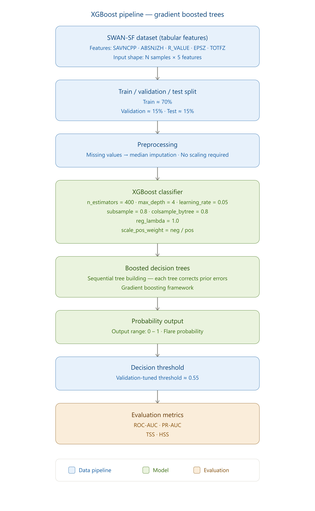
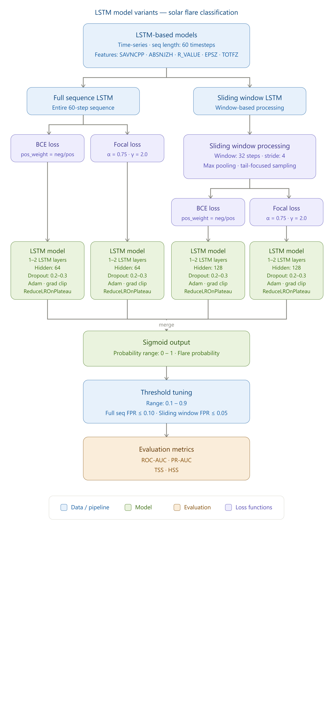
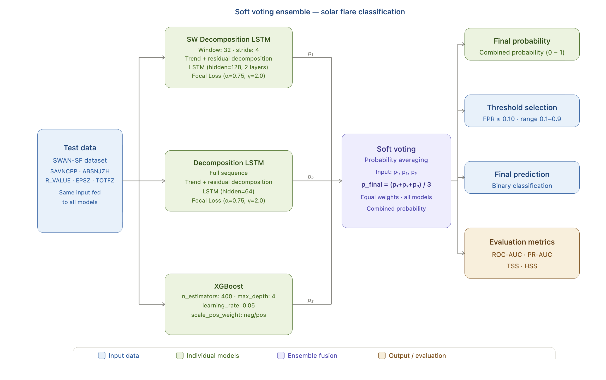
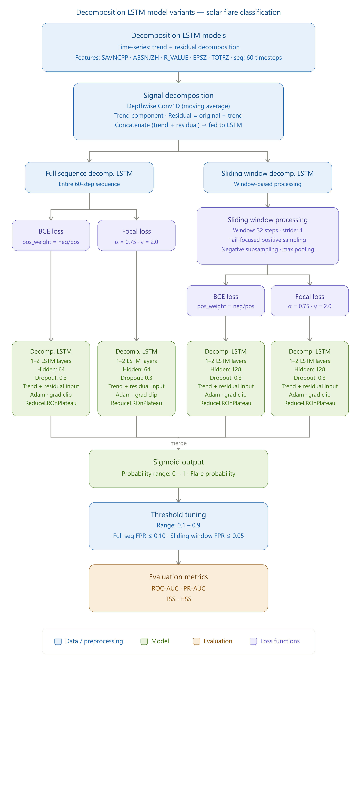
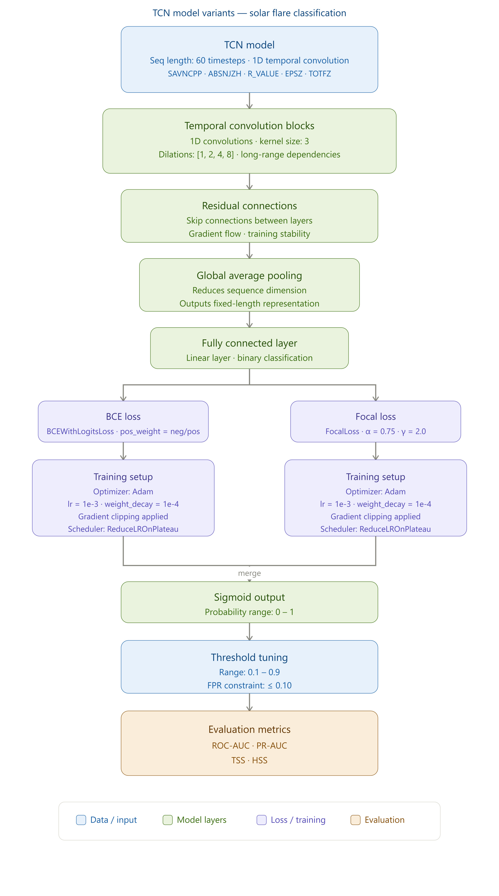

# Solar Flare Classification with SWAN-SF

A notebook-based study of binary solar-flare classification from multivariate solar active-region time series. The repository compares tabular baselines with whole-sequence and sliding-window deep-learning models, including LSTM, BiLSTM, decomposition LSTM, TCN, soft voting, and MCDM-based model selection.

The experiments focus on the five selected attributes used throughout the final sequence models:

`SAVNCPP`, `ABSNJZH`, `R_VALUE`, `EPSZ`, and `TOTFZ`

## Highlights

- Prepared tabular train, validation, and test splits for baseline models.
- Cleaned SWAN-SF sequence data stored in five train and five test partitions.
- Train-only normalization and a validation split taken from the final training partition.
- Threshold selection based on validation performance under a false-positive-rate constraint.
- Reusable loading, preprocessing, metric, loss, plotting, and sequence-dataloader utilities.
- Saved model probabilities and visual documentation of the main model pipelines.



## Results

The project evaluates performance with ROC-AUC, PR-AUC, TSS, HSS, and thresholded classification metrics. Because flare events are rare, ROC-AUC alone is not sufficient; precision, PR-AUC, TSS, HSS, and the false-positive rate are especially important.

The table below reports the main held-out test results documented in [`docs/interpretations.md`](docs/interpretations.md). Thresholds are selected on validation unless the row is explicitly labelled as a test sweep.

| Model | Test setting | Threshold | ROC-AUC | PR-AUC | TSS | HSS |
|---|---|---:|---:|---:|---:|---:|
| Logistic Regression | Validation threshold | 0.500 | 0.928 | 0.204 | 0.707 | 0.112 |
| XGBoost | Validation threshold | 0.550 | 0.960 | 0.370 | 0.737 | 0.289 |
| Whole-sequence LSTM, BCE | Validation threshold | 0.575 | 0.965 | 0.391 | 0.800 | 0.158 |
| Whole-sequence LSTM, Focal Loss | Validation threshold | 0.600 | 0.961 | 0.367 | 0.786 | 0.221 |
| Sliding-window LSTM, Focal Loss | FPR-constrained test sweep | 0.825 | 0.958 | 0.350 | 0.644 | 0.332 |
| BiLSTM, BCE | FPR-constrained test sweep | 0.850 | 0.964 | 0.388 | 0.805 | 0.256 |
| Decomposition LSTM, Focal Loss | FPR-constrained test sweep | 0.800 | 0.967 | 0.403 | 0.807 | 0.282 |
| Sliding-window decomposition LSTM, Focal Loss | FPR-constrained test sweep | 0.800 | 0.966 | 0.395 | 0.698 | 0.349 |
| TCN, Focal Loss | Validation threshold | 0.475 | 0.944 | 0.343 | 0.687 | 0.227 |
| Soft voting ensemble | FPR-constrained test sweep | 0.525 | 0.962 | 0.411 | 0.779 | 0.233 |

The strongest reported individual result is the **sliding-window decomposition LSTM with focal loss** under the FPR-constrained test sweep (`HSS=0.349`, `TSS=0.698`). The soft voting ensemble improves stability but does not exceed this individual model in HSS. The test-sweep rows are useful for comparative analysis, but should not be interpreted as unbiased deployment performance because the test labels are used to choose the displayed test threshold.



## Repository layout

```text
.
├── data/
│   ├── Cleaned SWANSF Dataset/       # Sequence partitions: train/ and test/
│   └── prepared/                     # Tabular train/validation/test CSV files
├── docs/
│   └── interpretations.md            # Detailed model results and interpretation
├── figures/                          # Static and interactive pipeline diagrams
├── notebooks/                        # Ordered exploration, modeling, and selection studies
├── outputs/                          # Saved probabilities and test labels
├── scripts/                          # Shared data, preprocessing, metrics, and plotting code
├── src/sdp/                          # SWAN-SF partition loader
├── requirements.txt
└── README.md
```

The included data directory is large. The sequence data consists of pickled arrays whose samples have shape `(n_samples, n_timesteps, 24)` and labels have shape `(n_samples,)`. The loader expects five partitions in each of `data/Cleaned SWANSF Dataset/train/` and `data/Cleaned SWANSF Dataset/test/`.

## Setup

Python 3.10 or newer is recommended. Create an environment and install the pinned minimum dependency versions:

```bash
python -m venv .venv
source .venv/bin/activate
python -m pip install --upgrade pip
python -m pip install -r requirements.txt
```

Check the local environment:

```bash
python scripts/check_env.py
```

To use the notebooks, start Jupyter from the repository root:

```bash
jupyter lab
```

The shared helpers locate the repository by looking for `src/sdp`, so notebook cells should be run with the project files in their original layout.

## Reproducing the workflow

Run the notebooks in numerical order:

| Notebook | Purpose |
|---|---|
| [`01_explore_swansf.ipynb`](notebooks/01_explore_swansf.ipynb) | Explore the sequence data, labels, feature distributions, and correlations. |
| [`02_prepare_swansf_splits.ipynb`](notebooks/02_prepare_swansf_splits.ipynb) | Prepare tabular train, validation, and test CSV splits. |
| [`03_tabular_baselines.ipynb`](notebooks/03_tabular_baselines.ipynb) | Train balanced Logistic Regression and XGBoost baselines. |
| [`04_lstm_full_sequence.ipynb`](notebooks/04_lstm_full_sequence.ipynb) | Train whole-sequence LSTM models with BCE and focal loss. |
| [`05_lstm_sliding_window.ipynb`](notebooks/05_lstm_sliding_window.ipynb) | Train sliding-window LSTM models and aggregate window predictions per sample. |
| [`06_bilstm_full_sequence.ipynb`](notebooks/06_bilstm_full_sequence.ipynb) | Compare whole-sequence BiLSTM loss variants. |
| [`07_decomposition_lstm_full_sequence.ipynb`](notebooks/07_decomposition_lstm_full_sequence.ipynb) | Add depthwise-convolution trend/residual decomposition before the LSTM. |
| [`08_sliding_window_decomposition_lstm.ipynb`](notebooks/08_sliding_window_decomposition_lstm.ipynb) | Combine sliding windows with trend/residual decomposition. |
| [`09_tcn_with_focal_loss.ipynb`](notebooks/09_tcn_with_focal_loss.ipynb) | Train a dilated residual Temporal Convolutional Network. |
| [`10_ensemble_soft_voting.ipynb`](notebooks/10_ensemble_soft_voting.ipynb) | Average probabilities from selected tabular and sequence models. |
| [`11_mcdm_weighted_scoring.ipynb`](notebooks/11_mcdm_weighted_scoring.ipynb) | Rank models with multi-criteria decision-making and weighted scoring. |



## Modeling protocol

1. Load the five train and five test sequence partitions.
2. Select the five attributes listed above from the 24 available attributes.
3. Use the final training partition as validation, matching the existing notebooks.
4. Fit normalization statistics on the training data only, then transform validation and test data.
5. Train a model with class-imbalance handling using either weighted BCE or focal loss.
6. Sweep classification thresholds on validation data, commonly subject to `FPR <= 0.10` or `FPR <= 0.05`.
7. Report validation-selected performance on the held-out test set.
8. For sliding-window models, aggregate window probabilities back to the original sample before scoring.

The reusable implementation is in [`scripts/data_utils.py`](scripts/data_utils.py), [`scripts/preprocessing.py`](scripts/preprocessing.py), [`scripts/evaluation.py`](scripts/evaluation.py), [`scripts/metrics.py`](scripts/metrics.py), and [`scripts/sequence_dataloader.py`](scripts/sequence_dataloader.py).



## Outputs and visual assets

Saved arrays in [`outputs/`](outputs/) include:

- `xgboost_probs.npy`
- `decomposition_lstm_probs.npy`
- `sliding_decomposition_lstm_probs.npy`
- `y_test.npy`

Static figures in [`figures/`](figures/) document data exploration, baseline pipelines, sequence architectures, ensemble construction, and MCDM selection. The most useful entry points are:

- [XGBoost pipeline](figures/xgboost_solar_flare_pipeline.jpg)
- [Logistic Regression pipeline](figures/logistic_regression_solar_flare_pipeline_pastel.jpg)
- [BiLSTM architecture](figures/bilstm_solar_flare_matched_style.jpg)
- [TCN architecture](figures/tcn_solar_flare_architecture.jpg)
- [MCDM model selection](figures/mcdm_model_selection.jpg)
- [Interactive LSTM model tree](figures/lstm_variants_tree_solar_flare_v2.html)
- [Interactive soft-voting diagram](figures/soft_voting_ensemble_improved.html)



## Metrics

- **ROC-AUC**: Ranking quality across thresholds.
- **PR-AUC**: Precision-recall performance, more informative than accuracy for rare events.
- **TSS**: True Skill Statistic, `TPR - FPR`.
- **HSS**: Heidke Skill Score, measuring improvement over chance while accounting for both classes.
- **FPR-constrained thresholding**: Selects a threshold that keeps false positives below an operational limit while maximizing TSS.

Metric implementations and safe zero-division handling are in [`scripts/metrics.py`](scripts/metrics.py). Detailed interpretation of every experiment is in [`docs/interpretations.md`](docs/interpretations.md).

## Notes on reproducibility

- Run from the repository root so relative data paths resolve correctly.
- The notebooks contain the experiment-specific hyperparameters and printed result tables.
- GPU acceleration is used automatically where the notebook implementation enables it, but CPU execution is supported with longer runtimes.
- Results can vary with random seeds, hardware, dependency versions, and reruns of training notebooks.
- The repository contains generated notebooks and figures; the README summarizes the latest results recorded in the project documentation rather than claiming a fresh rerun.
